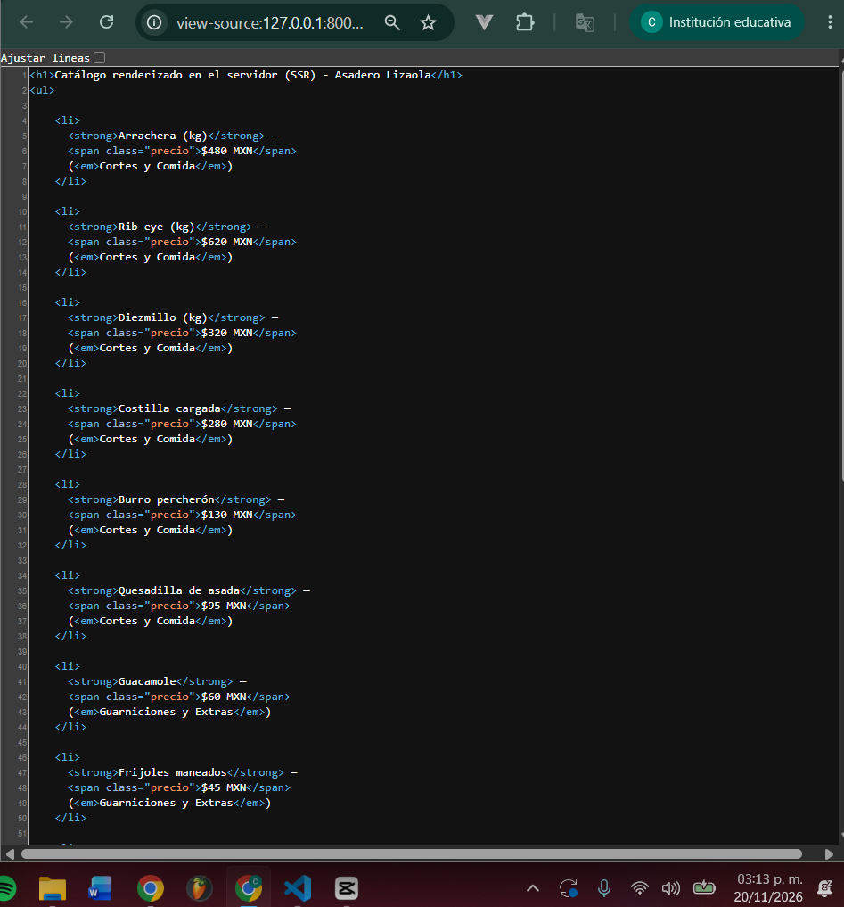
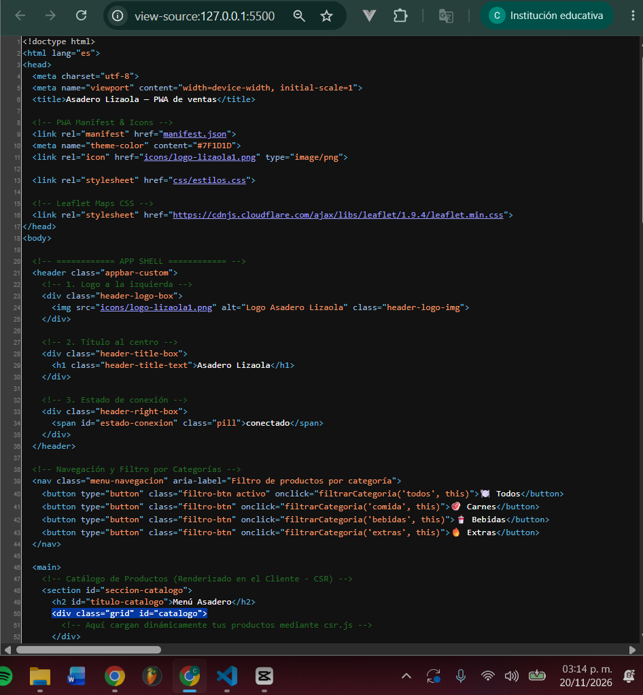
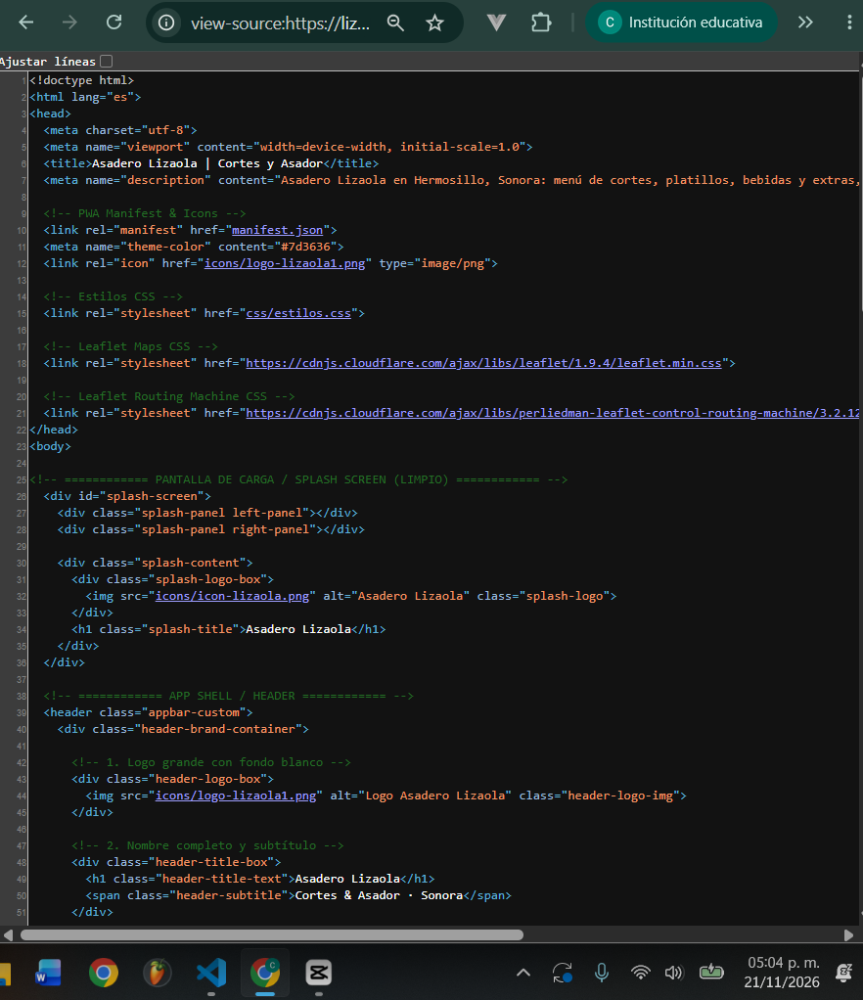
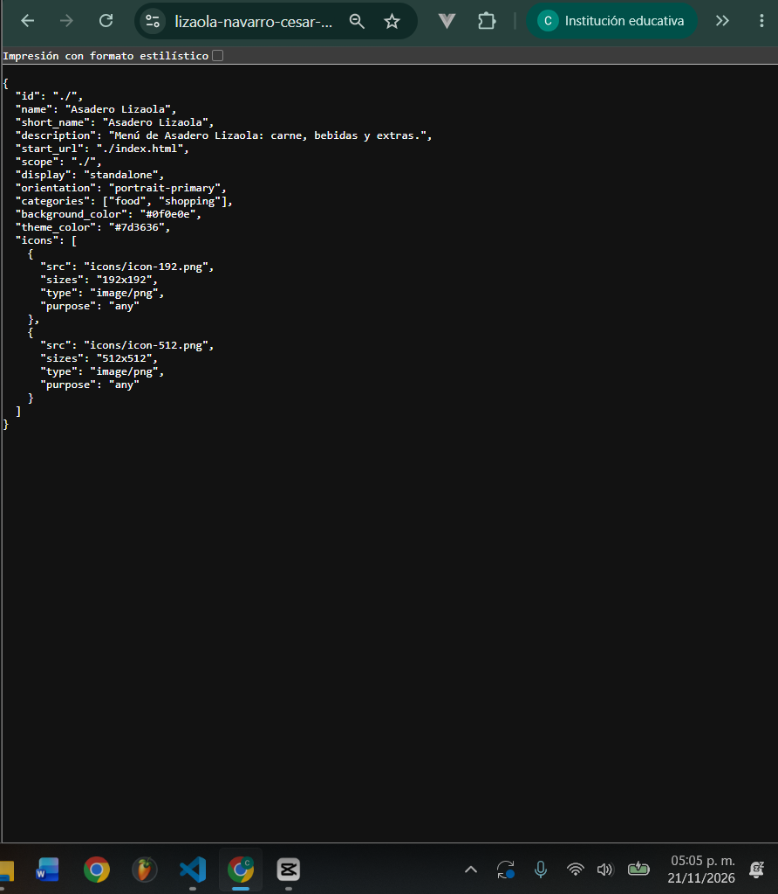
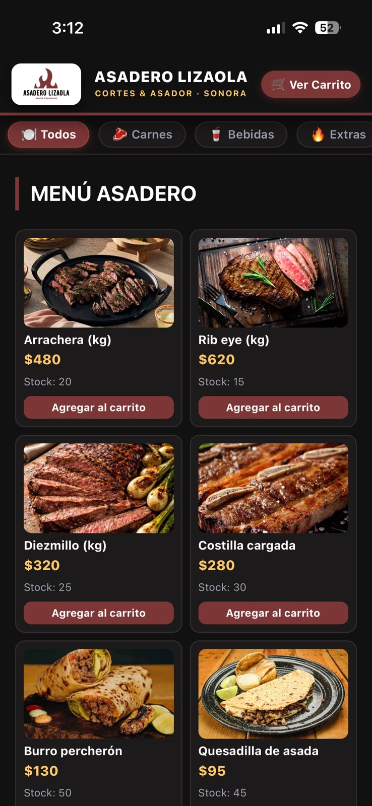

# Asadero Lizaola — PWA de ventas
 
PWA de ventas de la Unidad 2 (Aplicaciones Web Progresivas) para **Asadero Lizaola**, asadero de carne asada estilo Sonora en Hermosillo: catálogo de 15 productos con fotos y filtro por categoría, carrito guardado en `localStorage`, notificaciones, ruta a la sucursal en un mapa y Service Worker (Workbox) para funcionar sin conexión.
 
| Dato | Valor |
|---|---|
| **Alumno** | LIZAOLA NAVARRO CESAR ALBERTO |
| **Grupo** | ING10-1 |
| **Negocio · giro** | Asadero Lizaola · Asadero de carne estilo Sonora |
| **URL del repositorio** | https://github.com/lizaola-navarro-cesar-alberto/asadero-lizaola-pwa_lizaola-navarro-cesar-alberto |
| **URL de GitHub Pages** | https://lizaola-navarro-cesar-alberto.github.io/asadero-lizaola-pwa_lizaola-navarro-cesar-alberto/ |
 
## Estructura del repositorio
 
- **Raíz:** la PWA (`index.html`, `manifest.json`, `sw.js`, `css/`, `js/`, `img/`, `icons/`). Es lo que publica GitHub Pages.
- **`servidor-ssr/`:** mini proyecto Django con la vista SSR del catálogo, para comparar contra el CSR. Solo corre en local.
- **`docs/`:** reportes de Lighthouse, capturas y reporte de pruebas en PDF.
 
## 💻 Cómo probarla en local
 
1. Abre la carpeta del repositorio en VS Code.
2. Clic derecho en `index.html` → **Open with Live Server** (`http://localhost:5500/index.html`).
3. (Opcional, vista SSR) En la terminal: `cd servidor-ssr`, `venv\Scripts\activate`, `python manage.py runserver` y abre `http://127.0.0.1:8000/catalogo/`.
 
## 📱 Guía de Instalación
 
### En Dispositivos Android (Google Chrome)
1. Abre Google Chrome e ingresa a la URL de GitHub Pages.
2. Presiona el menú de tres puntos verticales (esquina superior derecha).
3. Selecciona la opción **"Instalar aplicación"** o **"Agregar a la pantalla principal"**.
4. Confirma la instalación cuando el navegador lo solicite.
5. Abre la PWA directamente desde el ícono de **Asadero Lizaola** generado en tu pantalla de inicio.
 
### En Dispositivos iOS / iPhone (Safari)
1. Abre Safari e ingresa a la URL de GitHub Pages.
2. Toca el botón **Compartir** (el ícono del cuadrado con la flecha hacia arriba en la barra inferior).
3. Desplázate hacia abajo y selecciona **"Agregar a inicio"**.
4. Confirma presionando **"Agregar"** en la esquina superior derecha.
5. Accede a la PWA a pantalla completa desde la pantalla de inicio de tu celular.
 
### En computadora (Chrome o Edge)
1. Abre la URL de GitHub Pages.
2. Haz clic en el ícono de instalar (⊕) de la barra de direcciones y confirma.
 
## 🍽️ Cómo usarla
 
1. **Menú:** usa los botones Todos, Carnes, Bebidas y Extras para filtrar los productos.
2. **Carrito:** pulsa "Agregar al carrito"; en el carrito cambia la cantidad con − y +, o quita productos. El carrito se guarda aunque cierres la app.
3. **Notificaciones:** pulsa "Activar Notificaciones" y acepta el permiso para recibir avisos.
4. **Ubicación:** pulsa "Calcular ruta desde mi ubicación" y acepta el permiso para ver en el mapa la ruta hasta la sucursal.
5. **Sin conexión:** después de abrirla una vez, la app carga aunque no haya internet (activa el modo avión y ábrela).
 
---
 
## Historial de avances
 
| Avance | Hash del commit entregado | Fecha |
|---|---|---|
| 1 | 12b7a0a | 11/10/2026 |
| 2 | d09441b | 20/11/2026 (recuperación) |
| 3 | cb730de | 25/10/2026 |
| 4 | (0bb66de) | 22/11/2026 (recuperación) |
 
## Comparación SSR vs CSR
 
### SSR (Django): los productos llegan escritos en el HTML

 
### CSR (JavaScript): el div del catálogo llega vacío

 
## Código fuente publicado en GitHub Pages
 
### index.html publicado: título, theme-color, manifest y registro del Service Worker

 
### manifest.json publicado

 
## Pruebas
 
- Reportes de Lighthouse: [móvil](docs/lighthouse-movil.html) · [escritorio](docs/lighthouse-escritorio.html)
- Reporte de pruebas (PDF): [LIZAOLA_NAVARRO_CESAR_ALBERTO_Evidencia2_U2.pdf](docs/LIZAOLA_NAVARRO_CESAR_ALBERTO_Evidencia2_U2.pdf)
 
### Aplicación instalada en el celular

