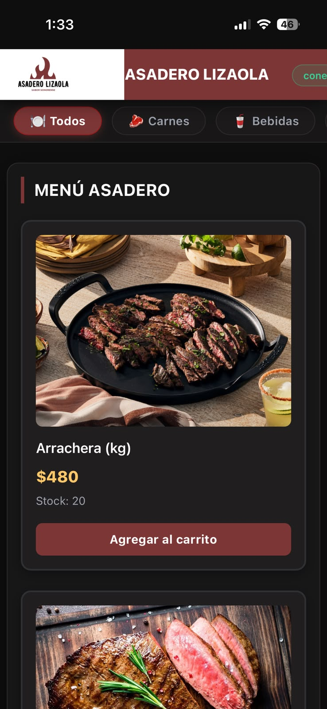

# Asadero Lizaola — PWA de ventas

| Dato | Valor |
|---|---|
| **Alumno** | LIZAOLA NAVARRO CESAR ALBERTO |
| **Grupo** | ING10-1 |
| **Negocio · giro** | Asadero Lizaola · Asadero de carne estilo Sonora |
| **URL del repositorio** | https://github.com/lizaola-navarro-cesar-alberto/asadero-lizaola-pwa_lizaola-navarro-cesar-alberto |
| **URL de GitHub Pages** | https://lizaola-navarro-cesar-alberto.github.io/asadero-lizaola-pwa_lizaola-navarro-cesar-alberto/ |

## 📱 Guía de Instalación

### En Dispositivos Android (Google Chrome)
1. Abre Google Chrome e ingresa a la URL de GitHub Pages.
2. Presiona el menú de tres puntos verticales (esquina superior derecha).
3. Selecciona la opción **"Instalar aplicación"** o **"Agregar a la pantalla principal"**.
4. Confirma la instalación cuando el navegador lo solicite.
5. Abre la PWA directamente desde el ícono de **Asadero Lizaola** generado en tu pantalla de inicio.

### En Dispositivos iOS / iPhone (Safari)
1. Abre Safari e ingresa a la URL de GitHub Pages.
2. Toca el botón **Compartir** (el ícono del cuadrado con la flecha hacia arriba en la barra inferior).
3. Desplázate hacia abajo y selecciona **"Agregar a inicio"**.
4. Confirma presionando **"Agregar"** en la esquina superior derecha.
5. Accede a la PWA a pantalla completa desde la pantalla de inicio de tu celular.

---

## Historial de avances

| Avance | Hash del commit entregado | Fecha |
|---|---|---|
| 1 | 12b7a0a | 11/10/2026 |
| 2 | 8e28672 | 18/10/2026 |
| 3 | cb730de | 25/10/2026 |
| 4 | (se escribe en el reporte PDF) | 01/11/2026 |

## Comparación SSR vs CSR

### SSR (Django): los productos llegan escritos en el HTML

### CSR (JavaScript): el div del catálogo llega vacío

## Implementación de PWA (Service Worker y Manifest)

### Registro de PWA y Scripts en index.html

### Configuración de Workbox y Precarga en el Service Worker

### 3. Aplicación Instalada en Dispositivo Móvil
